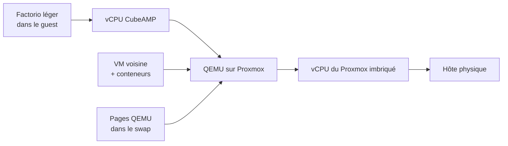

# J'ai retiré des ressources à Factorio — et les saccades ont disparu

J'étais seul sur mon serveur Factorio, mais chaque passage dans une zone minière donnait l'impression que le monde avançait par à-coups. Le client n'était pas saturé, la partie n'accueillait pas vingt joueurs et la VM CubeAMP disposait déjà de **6 vCPU et 16 Gio de RAM**. Mon premier réflexe aurait pu être de lui en donner davantage.

C'était précisément la mauvaise direction. Le détail qui changeait tout : **Proxmox tournait lui-même dans une VM**, limitée à 8 vCPU et environ 23 Gio de RAM. À l'intérieur, trois VM QEMU et dix-sept conteneurs actifs se partageaient ces ressources. Les 16 Gio attribués à CubeAMP n'étaient pas une réserve physique : c'était une promesse faite à l'intérieur d'une autre promesse.

> En une phrase : après avoir réduit CubeAMP de 6 à 4 vCPU, remis à zéro les **5 743 220 kB de `VmSwap`** de son processus QEMU et diminué la contention KVM globale, l'hôte est passé de **9–28 % à 93 % d'idle** sur les relevés comparables, puis j'ai joué environ une heure sans reproduire une seule saccade.
{: .prompt-info }

{: .shadow }
*Une allocation dans CubeAMP traverse deux planificateurs CPU et deux niveaux de gestion mémoire avant d'atteindre le matériel.*

## Le point de départ : une grosse VM dans un petit hôte

La topologie paraissait confortable quand je ne regardais que la VM de jeu. Elle l'était beaucoup moins à l'échelle de l'hôte Proxmox imbriqué.

| Zone | État initial |
|---|---|
| Hôte Proxmox imbriqué | 8 vCPU, environ 23 Gio de RAM, 16 Gio de swap |
| Charge active | 3 VM QEMU et 17 conteneurs LXC |
| VM CubeAMP | 6 vCPU, 16 384 Mio, ballooning désactivé |
| VM applicative voisine | 6 vCPU, jusqu'à 4 096 Mio |
| Factorio dans CubeAMP | environ 557 Mio de RSS, charge interne faible |
| Ressources théoriquement configurées | environ 47 Gio pour environ 23 Gio physiques |

Le paradoxe était déjà visible : Factorio lui-même ne manquait ni de RAM interne ni de CPU moyen. Dans son guest, la charge moyenne était de `0.42 / 0.21 / 0.18`, environ 14,5 Gio restaient disponibles et aucun swap n'était configuré.

Pourtant, un instantané montrait **16,7 % de steal** dans cette VM. Le processus Factorio pouvait être léger et attendre quand même qu'un vCPU lui soit réellement rendu par les couches supérieures.

## Trois couches à mesurer, pas une

Je ne cherchais pas un « tweak Factorio ». J'ai mesuré simultanément :

1. le processus Factorio dans le guest ;
2. la VM CubeAMP vue par Proxmox ;
3. Proxmox vu comme une VM KVM par son propre hôte.

Les commandes les plus utiles étaient volontairement simples :

```bash
# Pression CPU de l'hôte et pages QEMU évincées
cat /proc/pressure/cpu
grep -E 'VmRSS|VmSwap' /proc/$(cat /run/qemu-server/120.pid)/status
vmstat 1 5
```

Le verdict a contredit l'image donnée par `top` dans CubeAMP. L'hôte présentait une charge moyenne de `6.38 / 4.69 / 4.40`, jusqu'à **64 % de temps système**, seulement **9–28 % d'idle** sur les échantillons `vmstat` et un PSI CPU `some avg10` à **33,35 %**.

Deux processus QEMU consommaient ponctuellement environ **150 %** pour CubeAMP et **208 %** pour la VM applicative voisine. Le problème n'était donc pas « Factorio utilise trop de CPU », mais « les vCPU utiles doivent traverser un hôte déjà en contention ».

## Le swap que le guest ne pouvait pas voir

Le relevé décisif se trouvait dans `/proc` sur Proxmox :

| Processus QEMU | `VmRSS` | `VmSwap` |
|---|---:|---:|
| CubeAMP | 5 962 900 kB | **5 743 220 kB** |
| VM applicative | 2 261 032 kB | 653 032 kB |
| Troisième VM | 1 004 336 kB | 112 352 kB |

Cela ne signifie pas que « 5,7 Go des 5,9 Go de RSS étaient dans le swap » : `VmRSS` et `VmSwap` sont deux compteurs distincts. En revanche, le constat opérationnel est clair : **une quantité importante de pages du processus QEMU de CubeAMP avait été évincée vers le swap de l'hôte**.

{: .shadow }
*Le système invité voit de la RAM normale. Il ne sait pas que l'hôte a placé des pages de son processus QEMU sur disque.*

C'est le piège le plus contre-intuitif de cette intervention. Dans CubeAMP, `free` affichait zéro swap parce que le guest n'en avait pas. Un niveau plus bas, Proxmox pouvait tout de même échanger sa « RAM physique », qui n'était en réalité que la mémoire d'un processus QEMU.

> `Swap: 0` dans une VM ne prouve pas que ses pages restent en RAM. Sur un hôte suralloué, il faut aussi inspecter `VmSwap` du processus QEMU et la pression mémoire de l'hôte.
{: .prompt-warning }

## J'ai retiré des ressources au lieu d'en ajouter

Le premier lot de corrections a réduit la concurrence au lieu d'augmenter les plafonds :

- CubeAMP : **6 → 4 vCPU** ;
- mémoire CubeAMP : **16 384 → 6 144 Mio** pour Factorio seul ;
- poids CPU CubeAMP : `100 → 2048` ;
- `vm.swappiness` de Proxmox : **60 → 10** ;
- VM applicative voisine : **6 → 2 vCPU** ;
- KVM `halt_poll_ns` : **200000 → 0**.

```bash
# Réduire la demande et favoriser la VM de jeu
qm set 120 --cores 4 --cpuunits 2048
sysctl -w vm.swappiness=10

# Éviter le polling actif coûteux dans cet hôte imbriqué
echo 0 > /sys/module/kvm/parameters/halt_poll_ns
```

Le redémarrage de CubeAMP avait aussi une fonction importante : repartir avec des pages réellement résidentes. Juste après, son processus QEMU affichait **`VmSwap: 0 kB`**. Dans le guest, deux relevés `vmstat` montraient **98–99 % d'idle** et seulement **0–1 % de steal** avant le retour de la charge de jeu.

La VM applicative voisine méritait elle aussi une correction. Elle ne semblait pas très chargée de l'intérieur — entre 8 et 23 % pour son processus principal selon les instantanés — mais coûtait environ 95 à 208 % d'un cœur vue par l'hôte. Dans une virtualisation imbriquée, davantage de vCPU signifie aussi davantage d'ordonnancement, de réveils et de transitions KVM.



## Avant et après : ce que les instantanés montrent réellement

Les mesures suivantes ne sont pas une série temporelle de laboratoire. Ce sont des instantanés pris pendant une intervention réelle, avec la même infrastructure, avant puis après le lot de corrections.

| Indicateur | Avant | Après | Évolution observée |
|---|---:|---:|---:|
| CubeAMP — vCPU | 6 | **4** | −2 vCPU |
| CubeAMP — mémoire configurée | 16 384 Mio | **6 144 Mio** | adaptée à Factorio seul |
| CubeAMP QEMU — `VmSwap` | 5 743 220 kB | **0 kB** | pages remises en RAM |
| VM applicative — vCPU | 6 | **2** | −4 vCPU |
| VM applicative — CPU vu par l'hôte | 95–208 % | **29 %** | instantané après redémarrage |
| CubeAMP — CPU vu par l'hôte | 131–150 % | **26 %** | instantané après redémarrage |
| Temps système de l'hôte | 43–64 % | **2 %** | forte baisse |
| Idle de l'hôte | 9–28 % | **93 %** | marge retrouvée |
| PSI CPU `some avg10` | 33,35 % | **4,43 %** | pression fortement réduite |
| Steal dans CubeAMP | jusqu'à 16,7 % | **3 %** | attente réduite |

{: .shadow }
*La baisse est nette, mais le bandeau central compte : plusieurs paramètres ont changé ensemble.*

Après le retour du service, la VM applicative consommait 29 % d'un cœur côté hôte et CubeAMP 26 %. Proxmox affichait 93 % d'idle, 2 % de temps système et 2 % de steal. Un audit ultérieur, en régime calme, relevait encore **95 % d'idle** et un PSI CPU `some avg10` à **2,84 %**.

Enfin, j'ai joué environ **une heure** sur le même type de zone. Je n'ai reproduit aucune saccade.

C'est une validation opérationnelle convaincante pour mon usage, mais pas un benchmark scientifique : je n'ai pas enregistré les UPS, le temps de tick ou une trace réseau avant/après.

## La partie honnête : je n'ai pas isolé le réglage gagnant

Le résultat est réel, mais la causalité individuelle ne l'est pas. La mémoire, le nombre de vCPU, la priorité CPU, la VM voisine, le `swappiness`, le halt polling et les redémarrages ont changé dans la même séquence.

> Je peux affirmer que le système mesuré est devenu beaucoup moins contraint et que les saccades n'ont pas réapparu pendant mon test. Je ne peux pas affirmer que `halt_poll_ns=0`, les 4 vCPU ou le nettoyage du swap suffiraient seuls.
{: .prompt-danger }

Cette distinction compte. En incident réel, on privilégie parfois le retour à un état stable plutôt qu'un protocole A/B parfait. Il faut alors documenter honnêtement ce que les données prouvent — et ce qu'elles ne prouvent pas.

L'intervention a aussi connu plusieurs accrocs :

- Factorio **ne s'est pas relancé automatiquement** après le premier redémarrage ; j'ai dû démarrer manuellement son instance AMP ;
- le QEMU Guest Agent de la VM applicative ne répondait pas encore ; je l'ai installé ensuite et validé avec un ping agent ;
- AMP refusait de modifier l'autostart tant que son service de gestion tournait ; j'ai sauvegardé puis édité son état interne ;
- lors d'un redimensionnement ultérieur, un arrêt a renvoyé `VM quit/powerdown failed` et la VM a dû être relancée explicitement.

Une optimisation n'est pas terminée quand l'hyperviseur affiche `running`. Elle l'est quand le service écoute, que le jeu est joignable et que le mécanisme de redémarrage a été testé.

## Satisfactory a cassé ma conclusion trop simple

Avec Factorio seul, 6 Gio convenaient largement. Puis j'ai lancé Satisfactory dans la même VM. Son processus a atteint environ **3 878 024 KiB de RSS** ; CubeAMP n'avait plus que **939 Mio disponibles** sur ses 6 Gio.

La conclusion ne pouvait donc pas être « moins de RAM est toujours mieux ». La vraie règle est : **dimensionner sur le working set des charges réellement actives**, sans transformer chaque octet non utilisé en allocation permanente.

J'ai fait évoluer la configuration vers :

| Paramètre | Factorio seul | Factorio + Satisfactory |
|---|---:|---:|
| vCPU | 4 | **4** |
| Mémoire maximum | 6 144 Mio | **10 240 Mio** |
| Minimum balloon | désactivé | **8 192 Mio** |
| zswap sur Proxmox | désactivé | **zstd, pool max 15 %** |

{: .shadow }
*La configuration finale conserve 4 vCPU, mais adapte la mémoire aux deux serveurs et ajoute des amortisseurs côté hôte.*

Après redémarrage, les deux serveurs se sont lancés automatiquement. Le pilote `virtio_balloon` était chargé et zswap contenait environ **161 980 kB de données compressées représentant 390 776 kB de pages**. Le balloon n'avait cependant rendu qu'environ 318 Mio au moment du relevé (`10 240 → 9 922 Mio`).

Je présente donc ballooning et zswap comme des **protections contre une future pression mémoire**, pas comme une optimisation de latence déjà démontrée. Je n'ai pas refait une heure de jeu comparable après l'ajout de Satisfactory.

## Ce que je surveille maintenant

J'ai conservé le swap disque : le désactiver définitivement sur un hôte suralloué aurait remplacé les pauses potentielles par un risque d'OOM. En revanche, j'ai vidé les anciennes pages une fois la marge retrouvée. L'opération a pris **33,333 s** et a ramené le swap utilisé de 1 592 Mio à 0, pendant que la mémoire utilisée remontait logiquement d'environ 1,6 Gio.

Un contrôle périodique surveille désormais deux seuils :

- swap utilisé supérieur à **2 048 Mio** ;
- mémoire disponible inférieure à **2 500 Mio**.

L'alerte est limitée à une notification toutes les six heures pour éviter de transformer une pression mémoire en pression Telegram.

Les métriques que je regarde en priorité ne sont plus seulement le CPU moyen du processus de jeu :

| Niveau | Signaux utiles |
|---|---|
| Jeu | UPS, temps de tick, journal de sauvegarde |
| Guest CubeAMP | steal, mémoire disponible, processus actifs |
| QEMU | `VmSwap`, RSS, CPU du cgroup |
| Proxmox imbriqué | PSI CPU/mémoire, temps système, idle, swap |
| Hôte supérieur | capacité réellement garantie et contention externe |

## Bilan

| Élément | État stabilisé |
|---|---|
| Fluidité Factorio | environ 1 h de jeu sans saccade reproduite |
| CubeAMP | 4 vCPU, priorité CPU renforcée |
| Mémoire Factorio seul | 16 384 → 6 144 Mio |
| Mémoire avec Satisfactory | maximum 10 240 Mio, balloon minimum 8 192 Mio |
| `VmSwap` CubeAMP après premier redémarrage | **0 kB** |
| VM applicative voisine | 6 → 2 vCPU |
| KVM halt polling | 200000 → 0 |
| Protection mémoire | swappiness 10, zswap zstd, alertes de seuil |
| Limite de la preuve | changements groupés, pas de benchmark UPS contrôlé |

La leçon n'est pas qu'une VM rapide doit avoir peu de ressources. Elle est qu'**une allocation n'est pas une capacité garantie**. Dans une infrastructure imbriquée, chaque vCPU et chaque page mémoire passent par plusieurs planificateurs qui peuvent promettre davantage que ce que l'hôte peut fournir au même instant.

La question n'était plus « combien de CPU donner à Factorio ? », mais « combien de contention toute la pile peut-elle absorber sans introduire de pauses ? ». Optimiser une VM sans regarder son hôte revient à régler un moteur sans savoir sur quelle route il roule.
