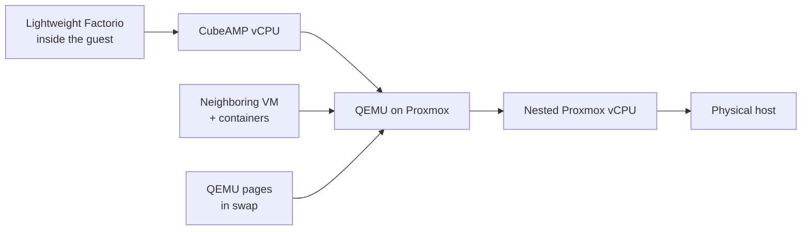

# I took resources away from Factorio—and the stuttering disappeared

I was alone on my Factorio server, but every time I crossed a mining area, the world seemed to move in fits and starts. The client was not saturated, the game did not have twenty players, and the CubeAMP VM already had **6 vCPUs and 16 GiB of RAM**. My first instinct could have been to give it more.

That was precisely the wrong direction. The detail that changed everything: **Proxmox was itself running in a VM**, limited to 8 vCPUs and about 23 GiB of RAM. Inside it, three QEMU VMs and seventeen active containers shared those resources. The 16 GiB assigned to CubeAMP was not a physical reserve; it was a promise made inside another promise.

> In one sentence: after reducing CubeAMP from 6 to 4 vCPUs, resetting the **5 743 220 kB of `VmSwap`** used by its QEMU process to zero, and reducing overall KVM contention, the host went from **9–28% to 93% idle** in comparable samples, after which I played for about an hour without reproducing a single stutter.
{: .prompt-info }

{: .shadow }
*An allocation in CubeAMP passes through two CPU schedulers and two levels of memory management before reaching the hardware.*

## Starting point: a large VM on a small host

The topology looked comfortable when I considered only the game VM. It looked much less so at the scale of the nested Proxmox host.

| Area | Initial state |
|---|---|
| Nested Proxmox host | 8 vCPUs, about 23 GiB of RAM, 16 GiB of swap |
| Active workload | 3 QEMU VMs and 17 LXC containers |
| CubeAMP VM | 6 vCPUs, 16 384 MiB, ballooning disabled |
| Neighboring application VM | 6 vCPUs, up to 4 096 MiB |
| Factorio inside CubeAMP | about 557 MiB RSS, low internal load |
| Theoretically allocated resources | about 47 GiB backed by about 23 GiB of physical memory |

The paradox was already visible: Factorio itself was not short of guest RAM or average CPU capacity. Inside its guest, the load average was `0.42 / 0.21 / 0.18`, about 14.5 GiB remained available, and no swap was configured.

Yet one snapshot showed **16.7% steal** in that VM. The Factorio process could be lightweight and still have to wait for the upper layers to actually schedule one of its vCPUs.

## Three layers to measure, not one

I was not looking for a “Factorio tweak.” I measured three layers simultaneously:

1. the Factorio process inside the guest;
2. the CubeAMP VM as seen by Proxmox;
3. Proxmox as seen by the KVM host running it as a VM.

The most useful commands were deliberately simple:

```bash
# Host CPU pressure and evicted QEMU pages
cat /proc/pressure/cpu
grep -E 'VmRSS|VmSwap' /proc/$(cat /run/qemu-server/120.pid)/status
vmstat 1 5
```

The verdict contradicted the picture shown by `top` inside CubeAMP. The host had a load average of `6.38 / 4.69 / 4.40`, up to **64% system CPU time**, only **9–28% idle** across the `vmstat` samples, and CPU PSI `some avg10` at **33.35%**.

At times, two QEMU processes consumed about **150%** for CubeAMP and **208%** for the neighboring application VM. The problem was therefore not “Factorio uses too much CPU,” but “the vCPUs doing useful work have to pass through a host that is already contended.”

## The swap the guest could not see

The decisive reading came from `/proc` on Proxmox:

| QEMU process | `VmRSS` | `VmSwap` |
|---|---:|---:|
| CubeAMP | 5 962 900 kB | **5 743 220 kB** |
| Application VM | 2 261 032 kB | 653 032 kB |
| Third VM | 1 004 336 kB | 112 352 kB |

This does not mean that “5.7 GB of the 5.9 GB RSS was in swap”: `VmRSS` and `VmSwap` are two separate counters. The operational finding is clear, however: **a substantial number of pages belonging to CubeAMP's QEMU process had been evicted to the host's swap**.

{: .shadow }
*The guest sees ordinary RAM. It does not know that the host has placed pages from its QEMU process on disk.*

This is the most counterintuitive trap I encountered during this work. Inside CubeAMP, `free` reported zero swap because the guest had none. One layer down, Proxmox could still swap its “physical RAM,” which was actually just memory belonging to a QEMU process.

> `Swap: 0` inside a VM does not prove that its pages remain in RAM. On an overcommitted host, you must also inspect the QEMU process's `VmSwap` and the host's memory pressure.
{: .prompt-warning }

## I took resources away instead of adding more

The first batch of changes reduced competition instead of raising limits:

- CubeAMP: **6 → 4 vCPUs**;
- CubeAMP memory: **16 384 → 6 144 MiB** for Factorio alone;
- CubeAMP CPU weight: `100 → 2048`;
- Proxmox `vm.swappiness`: **60 → 10**;
- neighboring application VM: **6 → 2 vCPUs**;
- KVM `halt_poll_ns`: **200000 → 0**.

```bash
# Reduce demand and prioritize the game VM
qm set 120 --cores 4 --cpuunits 2048
sysctl -w vm.swappiness=10

# Avoid costly active polling on this nested host
echo 0 > /sys/module/kvm/parameters/halt_poll_ns
```

Restarting CubeAMP served another important purpose: it brought its pages back into resident memory. Immediately afterward, its QEMU process reported **`VmSwap: 0 kB`**. Inside the guest, two `vmstat` samples showed **98–99% idle** and only **0–1% steal** before the game load returned.

The neighboring application VM also needed adjustment. It did not appear heavily loaded from the inside—between 8 and 23% for its main process depending on the snapshot—but it cost about 95 to 208% of one core from the host's perspective. Under nested virtualization, more vCPUs also mean more scheduling, wake-ups, and KVM transitions.



## Before and after: what the snapshots actually show

The following measurements are not a laboratory time series. They are snapshots taken during a real intervention on the same infrastructure, before and after the batch of changes.

| Metric | Before | After | Observed change |
|---|---:|---:|---:|
| CubeAMP — vCPUs | 6 | **4** | −2 vCPUs |
| CubeAMP — configured memory | 16 384 MiB | **6 144 MiB** | sized for Factorio alone |
| CubeAMP QEMU — `VmSwap` | 5 743 220 kB | **0 kB** | pages brought back into RAM |
| Application VM — vCPUs | 6 | **2** | −4 vCPUs |
| Application VM — CPU seen by host | 95–208% | **29%** | post-restart snapshot |
| CubeAMP — CPU seen by host | 131–150% | **26%** | post-restart snapshot |
| Host system CPU time | 43–64% | **2%** | sharp decrease |
| Host idle | 9–28% | **93%** | headroom restored |
| CPU PSI `some avg10` | 33.35% | **4.43%** | pressure greatly reduced |
| Steal inside CubeAMP | up to 16.7% | **3%** | less waiting |

{: .shadow }
*The decrease is clear, but the middle banner matters: several parameters changed together.*

After the service came back, the application VM consumed 29% of one core on the host, and CubeAMP consumed 26%. Proxmox reported 93% idle, 2% system CPU time, and 2% steal. A later audit under light load still measured **95% idle** and CPU PSI `some avg10` at **2.84%**.

Finally, I played for about **one hour** in the same type of area. I did not reproduce any stuttering.

That is convincing operational validation for my use case, but not a scientific benchmark: I did not record UPS, tick time, or a network trace before and after.

## The honest part: I did not isolate the winning setting

The result is real, but individual causality is not. Memory, the vCPU count, CPU priority, the neighboring VM, `swappiness`, halt polling, and restarts all changed in the same sequence.

> I can say that the measured system became far less constrained and that the stuttering did not return during my test. I cannot say that `halt_poll_ns=0`, the 4 vCPUs, or clearing swap would have been sufficient on their own.
{: .prompt-danger }

That distinction matters. During a real incident, restoring a stable state sometimes takes priority over running a perfect A/B protocol. In that case, you must document honestly what the data proves—and what it does not.

The intervention also ran into several issues:

- Factorio **did not restart automatically** after the first reboot; I had to start its AMP instance manually;
- the QEMU Guest Agent in the application VM was not responding yet; I installed it afterward and validated it with an agent ping;
- AMP refused to change autostart while its management service was running; I backed up and then edited its internal state;
- during a later resize, a shutdown returned `VM quit/powerdown failed`, and the VM had to be restarted explicitly.

An optimization is not finished when the hypervisor reports `running`. It is finished when the service is listening, the game is reachable, and the restart mechanism has been tested.

## Satisfactory broke my overly simple conclusion

With Factorio alone, 6 GiB was more than enough. Then I launched Satisfactory in the same VM. Its process reached about **3 878 024 KiB RSS**; CubeAMP had only **939 MiB available** out of its 6 GiB.

The conclusion therefore could not be “less RAM is always better.” The real rule is: **size for the working set of the workloads that are actually active**, without turning every unused byte into a permanent allocation.

I evolved the configuration to:

| Parameter | Factorio alone | Factorio + Satisfactory |
|---|---:|---:|
| vCPUs | 4 | **4** |
| Maximum memory | 6 144 MiB | **10 240 MiB** |
| Minimum balloon | disabled | **8 192 MiB** |
| zswap on Proxmox | disabled | **zstd, max pool 15%** |

{: .shadow }
*The final configuration keeps 4 vCPUs but adjusts memory for both servers and adds safeguards on the host.*

After the restart, both servers started automatically. The `virtio_balloon` driver was loaded, and zswap held about **161 980 kB of compressed data representing 390 776 kB of pages**. However, the balloon had returned only about 318 MiB at the time of the reading (`10 240 → 9 922 MiB`).

I therefore present ballooning and zswap as **safeguards against future memory pressure**, not as an already proven latency optimization. I did not repeat a comparable hour of gameplay after adding Satisfactory.

## What I monitor now

I kept disk swap: permanently disabling it on an overcommitted host would have traded potential pauses for an OOM risk. I did, however, flush the old pages once enough headroom had been restored. The operation took **33.333 s** and reduced swap usage from 1 592 MiB to 0, while used memory logically rose by about 1.6 GiB.

A periodic check now monitors two thresholds:

- swap usage above **2 048 MiB**;
- available memory below **2 500 MiB**.

The alert is limited to one notification every six hours to avoid turning memory pressure into Telegram pressure.

The metrics I prioritize are no longer limited to the game process's average CPU usage:

| Level | Useful signals |
|---|---|
| Game | UPS, tick time, save log |
| CubeAMP guest | steal, available memory, active processes |
| QEMU | `VmSwap`, RSS, cgroup CPU usage |
| Nested Proxmox | CPU/memory PSI, system CPU time, idle, swap |
| Upper-level host | actual guaranteed capacity and external contention |

## Summary

| Item | Stabilized state |
|---|---|
| Factorio smoothness | about 1 h of gameplay without reproduced stuttering |
| CubeAMP | 4 vCPUs, increased CPU priority |
| Memory with Factorio alone | 16 384 → 6 144 MiB |
| Memory with Satisfactory | maximum 10 240 MiB, minimum balloon 8 192 MiB |
| CubeAMP `VmSwap` after first restart | **0 kB** |
| Neighboring application VM | 6 → 2 vCPUs |
| KVM halt polling | 200000 → 0 |
| Memory safeguards | swappiness 10, zswap zstd, threshold alerts |
| Limit of the evidence | grouped changes, no controlled UPS benchmark |

The lesson is not that a fast VM should have few resources. It is that **an allocation is not guaranteed capacity**. In nested infrastructure, every vCPU and every memory page passes through several schedulers that can promise more than the host can provide at any given moment.

The question was no longer “how much CPU should I give Factorio?” but “how much contention can the entire stack absorb without introducing pauses?” Optimizing a VM without looking at its host is like tuning an engine without knowing what road it will be driving on.
