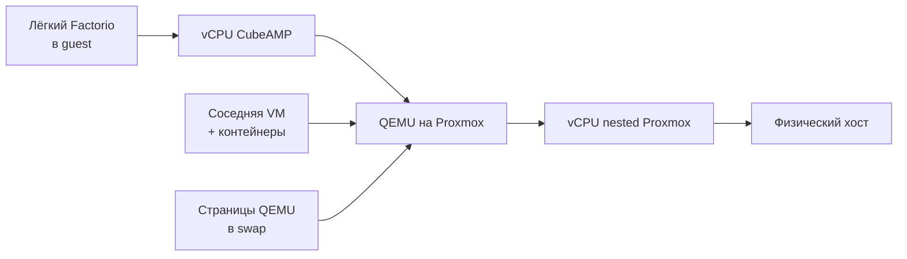

# Я забрал у Factorio ресурсы — и рывки исчезли

На своём сервере Factorio я играл один, но каждый проход через зону добычи создавал ощущение, будто мир движется рывками. Клиент не был перегружен, в игре не было двадцати игроков, а виртуальной машине CubeAMP уже были выделены **6 vCPU и 16 ГиБ RAM**. Первым порывом могло стать желание добавить ей ещё ресурсов.

Именно это было бы ошибкой. Деталь, менявшая всё: **сам Proxmox работал в VM**, ограниченной 8 vCPU и примерно 23 ГиБ RAM. Внутри него эти ресурсы делили три VM QEMU и семнадцать активных контейнеров. Выделенные CubeAMP 16 ГиБ были не физическим резервом, а обещанием внутри другого обещания.

> Если кратко: сократив CubeAMP с 6 до 4 vCPU, обнулив **5 743 220 kB `VmSwap`** её процесса QEMU и снизив общий уровень contention в KVM, я добился роста idle хоста с **9–28 % до 93 %** на сопоставимых замерах, а затем играл около часа, не воспроизведя ни одного рывка.
{: .prompt-info }

{: .shadow }
*Ресурсы, выделенные в CubeAMP, проходят через два CPU-планировщика и два уровня управления памятью, прежде чем достигнуть оборудования.*

## Исходная точка: большая VM на маленьком хосте

Топология выглядела комфортной, пока я смотрел только на игровую VM. В масштабе nested-хоста Proxmox картина была гораздо менее благополучной.

| Зона | Исходное состояние |
|---|---|
| Nested-хост Proxmox | 8 vCPU, около 23 ГиБ RAM, 16 ГиБ swap |
| Активная нагрузка | 3 VM QEMU и 17 контейнеров LXC |
| VM CubeAMP | 6 vCPU, 16 384 МиБ, ballooning отключён |
| Соседняя прикладная VM | 6 vCPU, до 4 096 МиБ |
| Factorio в CubeAMP | около 557 МиБ RSS, низкая внутренняя нагрузка |
| Теоретически настроенные ресурсы | около 47 ГиБ на примерно 23 ГиБ физической памяти |

Парадокс уже был заметен: самому Factorio не недоставало ни RAM внутри VM, ни средней CPU-мощности. В его guest средняя нагрузка составляла `0.42 / 0.21 / 0.18`, доступными оставались около 14,5 ГиБ, а swap не был настроен.

Тем не менее один из снимков показывал в этой VM **16,7 % steal**. Процесс Factorio мог быть лёгким и всё равно ждать, пока верхние слои действительно вернут ему vCPU.

## Измерять нужно три слоя, а не один

Я искал не «твик для Factorio». Я одновременно измерял:

1. процесс Factorio внутри guest;
2. VM CubeAMP с точки зрения Proxmox;
3. Proxmox с точки зрения его собственного хоста, где он работал как VM KVM.

Самые полезные команды были намеренно простыми:

```bash
# CPU pressure хоста и вытесненные страницы QEMU
cat /proc/pressure/cpu
grep -E 'VmRSS|VmSwap' /proc/$(cat /run/qemu-server/120.pid)/status
vmstat 1 5
```

Результат противоречил картине, которую показывал `top` внутри CubeAMP. Средняя нагрузка хоста составляла `6.38 / 4.69 / 4.40`, системное время доходило до **64 %**, idle на выборках `vmstat` составлял всего **9–28 %**, а PSI CPU `some avg10` — **33,35 %**.

Два процесса QEMU временами потребляли около **150 %** для CubeAMP и **208 %** для соседней прикладной VM. Поэтому проблема звучала не как «Factorio использует слишком много CPU», а как «полезным vCPU приходится проходить через хост с уже высоким уровнем contention».

## Swap, которого guest не видел

Решающие данные нашлись в `/proc` на Proxmox:

| Процесс QEMU | `VmRSS` | `VmSwap` |
|---|---:|---:|
| CubeAMP | 5 962 900 kB | **5 743 220 kB** |
| Прикладная VM | 2 261 032 kB | 653 032 kB |
| Третья VM | 1 004 336 kB | 112 352 kB |

Это не означает, что «5,7 ГБ из 5,9 ГБ RSS находились в swap»: `VmRSS` и `VmSwap` — два разных счётчика. Но операционный вывод однозначен: **значительный объём страниц процесса QEMU CubeAMP был вытеснен в swap хоста**.

{: .shadow }
*Гостевая система видит обычную RAM. Она не знает, что хост разместил страницы её процесса QEMU на диске.*

Это самая контринтуитивная ловушка во всей этой работе. В CubeAMP команда `free` показывала нулевой swap, потому что у guest его не было. Но уровнем ниже Proxmox всё равно мог выгружать в swap её «физическую RAM», которая в действительности была всего лишь памятью процесса QEMU.

> `Swap: 0` в VM не доказывает, что её страницы остаются в RAM. На overcommit-хосте нужно также проверять `VmSwap` процесса QEMU и memory pressure хоста.
{: .prompt-warning }

## Я забрал ресурсы вместо того, чтобы добавить их

Первый пакет исправлений сократил конкуренцию вместо увеличения лимитов:

- CubeAMP: **6 → 4 vCPU**;
- память CubeAMP: **16 384 → 6 144 МиБ** для одного Factorio;
- вес CPU CubeAMP: `100 → 2048`;
- `vm.swappiness` в Proxmox: **60 → 10**;
- соседняя прикладная VM: **6 → 2 vCPU**;
- KVM `halt_poll_ns`: **200000 → 0**.

```bash
# Снизить запрос ресурсов и отдать приоритет игровой VM
qm set 120 --cores 4 --cpuunits 2048
sysctl -w vm.swappiness=10

# Избежать дорогостоящего активного polling на этом nested-хосте
echo 0 > /sys/module/kvm/parameters/halt_poll_ns
```

Перезапуск CubeAMP выполнял ещё одну важную задачу: позволял начать заново с действительно резидентными страницами. Сразу после него процесс QEMU показывал **`VmSwap: 0 kB`**. Внутри guest два замера `vmstat` показывали **98–99 % idle** и лишь **0–1 % steal** до возврата игровой нагрузки.

Соседняя прикладная VM тоже нуждалась в корректировке. Изнутри она не казалась сильно нагруженной — её основной процесс потреблял от 8 до 23 % в разных снимках, — но с точки зрения хоста стоила примерно 95–208 % одного ядра. В nested-виртуализации больше vCPU означает также больше планирования, пробуждений и переходов KVM.



## До и после: что на самом деле показывают снимки

Следующие замеры — не лабораторный временной ряд. Это снимки одной и той же инфраструктуры, сделанные во время реальной работы до и после применения пакета исправлений.

| Показатель | До | После | Наблюдаемое изменение |
|---|---:|---:|---:|
| CubeAMP — vCPU | 6 | **4** | −2 vCPU |
| CubeAMP — настроенная память | 16 384 МиБ | **6 144 МиБ** | адаптирована для одного Factorio |
| QEMU CubeAMP — `VmSwap` | 5 743 220 kB | **0 kB** | страницы возвращены в RAM |
| Прикладная VM — vCPU | 6 | **2** | −4 vCPU |
| Прикладная VM — CPU с точки зрения хоста | 95–208 % | **29 %** | снимок после перезапуска |
| CubeAMP — CPU с точки зрения хоста | 131–150 % | **26 %** | снимок после перезапуска |
| Системное время хоста | 43–64 % | **2 %** | резкое снижение |
| Idle хоста | 9–28 % | **93 %** | запас восстановлен |
| PSI CPU `some avg10` | 33,35 % | **4,43 %** | pressure существенно снизился |
| Steal в CubeAMP | до 16,7 % | **3 %** | ожидание сократилось |

{: .shadow }
*Снижение очевидно, но важна центральная плашка: несколько параметров изменились одновременно.*

После возвращения сервиса прикладная VM потребляла 29 % одного ядра на стороне хоста, а CubeAMP — 26 %. Proxmox показывал 93 % idle, 2 % системного времени и 2 % steal. Более поздняя проверка в спокойном режиме всё ещё показывала **95 % idle** и PSI CPU `some avg10` на уровне **2,84 %**.

Наконец, я играл около **одного часа** в зоне того же типа. Ни одного рывка воспроизвести не удалось.

Для моего сценария это убедительная эксплуатационная проверка, но не научный benchmark: я не записывал UPS, tick time или сетевую трассировку до и после.

## Честная часть: я не изолировал победившую настройку

Результат реален, но индивидуальная причинно-следственная связь — нет. Память, число vCPU, приоритет CPU, соседняя VM, `swappiness`, halt polling и перезапуски менялись в одной последовательности.

> Я могу утверждать, что измеряемая система стала испытывать значительно меньше ограничений и что во время моего теста рывки больше не появлялись. Но я не могу утверждать, что одних только `halt_poll_ns=0`, 4 vCPU или очистки swap было бы достаточно.
{: .prompt-danger }

Это важное различие. Во время реального инцидента возврат в стабильное состояние иногда важнее идеального A/B-протокола. В таком случае нужно честно задокументировать, что именно доказывают данные — и чего они не доказывают.

Во время работы возникло и несколько проблем:

- Factorio **не запустился автоматически** после первого перезапуска; мне пришлось вручную запустить его экземпляр AMP;
- QEMU Guest Agent прикладной VM всё ещё не отвечал; я установил его позже и проверил с помощью agent ping;
- AMP не позволял изменить autostart, пока работал его сервис управления; я сделал резервную копию, а затем отредактировал его внутреннее состояние;
- во время более позднего изменения размера остановка вернула `VM quit/powerdown failed`, и VM пришлось явно запустить снова.

Оптимизация не заканчивается, когда гипервизор показывает `running`. Она заканчивается, когда сервис слушает порт, игра доступна, а механизм перезапуска протестирован.

## Satisfactory сломал мой слишком простой вывод

Для одного Factorio 6 ГиБ было более чем достаточно. Затем я запустил в той же VM Satisfactory. Его процесс достиг примерно **3 878 024 KiB RSS**; в CubeAMP оставалось лишь **939 МиБ доступной памяти** из 6 ГиБ.

Поэтому вывод не мог звучать как «меньше RAM всегда лучше». Настоящее правило таково: **размер нужно определять по working set реально активных нагрузок**, не превращая каждый неиспользуемый байт в постоянное выделение.

Я изменил конфигурацию следующим образом:

| Параметр | Только Factorio | Factorio + Satisfactory |
|---|---:|---:|
| vCPU | 4 | **4** |
| Максимальная память | 6 144 МиБ | **10 240 МиБ** |
| Минимальный balloon | отключён | **8 192 МиБ** |
| zswap на Proxmox | отключён | **zstd, pool max 15 %** |

{: .shadow }
*Финальная конфигурация сохраняет 4 vCPU, но адаптирует память под два сервера и добавляет защитные механизмы на стороне хоста.*

После перезапуска оба сервера запустились автоматически. Драйвер `virtio_balloon` был загружен, а zswap содержал около **161 980 kB сжатых данных, представлявших 390 776 kB страниц**. Однако к моменту замера balloon вернул лишь около 318 МиБ (`10 240 → 9 922 МиБ`).

Поэтому ballooning и zswap я рассматриваю как **защиту от будущего memory pressure**, а не как уже доказанную оптимизацию latency. После добавления Satisfactory я не повторял сопоставимый часовой игровой тест.

## Что я отслеживаю теперь

Дисковый swap я сохранил: его полное отключение на overcommit-хосте заменило бы потенциальные паузы риском OOM. Но после восстановления запаса я очистил старые страницы. Операция заняла **33,333 с** и сократила используемый swap с 1 592 МиБ до 0, при этом объём используемой памяти закономерно вырос примерно на 1,6 ГиБ.

Теперь периодическая проверка отслеживает два порога:

- используемый swap больше **2 048 МиБ**;
- доступная память меньше **2 500 МиБ**.

Частота оповещений ограничена одним уведомлением раз в шесть часов, чтобы не превращать memory pressure в Telegram pressure.

Теперь я в первую очередь смотрю не только на средний CPU игрового процесса:

| Уровень | Полезные сигналы |
|---|---|
| Игра | UPS, tick time, журнал сохранений |
| Guest CubeAMP | steal, доступная память, активные процессы |
| QEMU | `VmSwap`, RSS, CPU cgroup |
| Nested Proxmox | PSI CPU/памяти, системное время, idle, swap |
| Вышестоящий хост | реально гарантированная мощность и внешняя конкуренция за ресурсы |

## Итоги

| Элемент | Стабилизированное состояние |
|---|---|
| Плавность Factorio | около 1 ч игры без воспроизведённых рывков |
| CubeAMP | 4 vCPU, повышенный приоритет CPU |
| Память только для Factorio | 16 384 → 6 144 МиБ |
| Память с Satisfactory | максимум 10 240 МиБ, минимум balloon 8 192 МиБ |
| `VmSwap` CubeAMP после первого перезапуска | **0 kB** |
| Соседняя прикладная VM | 6 → 2 vCPU |
| KVM halt polling | 200000 → 0 |
| Защита памяти | swappiness 10, zswap zstd, пороговые оповещения |
| Ограничение доказательств | сгруппированные изменения, без контролируемого benchmark UPS |

Урок не в том, что быстрой VM нужно мало ресурсов. Он в том, что **выделение ресурсов не означает гарантированную мощность**. В nested-инфраструктуре каждый vCPU и каждая страница памяти проходят через несколько планировщиков, которые могут пообещать больше, чем хост способен предоставить одновременно.

Вопрос теперь звучал не как «сколько CPU выделить Factorio?», а как «какой уровень contention способен выдержать весь стек, не создавая пауз?». Оптимизировать VM, не глядя на её хост, — всё равно что настраивать двигатель, не зная, по какой дороге он едет.
